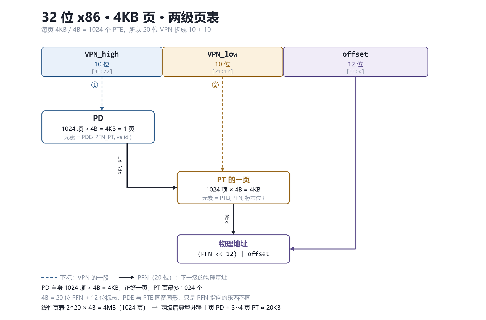
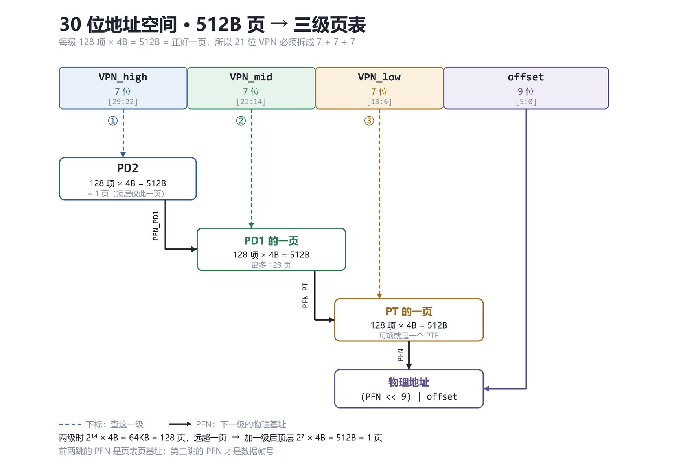

#### 零、页表空间开销的优化

通过第十八章的学习，我们得知了页表有时间和空间两个方面的开销！在第十九章中，TLB成为了时间开销的解法；而这一章，将要讨论空间开销的优化。

回忆十八章的内容，当时学习的页表是简单的线性页表，以下标为`VPN`，元素个数为`总物理内存空间 / 页大小`（即总共有这么多物理页）。在32位的`x86`中，`PTE`大小为4B、物理空间4GB、页大小4KB，可以算出单个进程的页表就有4MB之多。进程数量增加，页表们占领的内存也增加。

本章CRUX：如何让页表变小？代价是什么？

*事实上，本章是空间开销优化的引入，特别是多级页表的引入；恰因为是引入，也不会展开太详细的内容。*

#### 一、解法一：Bigger Pages

20.1小节，作者讨论了第一种让页表变小的解法——加大页的空间。

这是一个从公式上得出的解法：**一个页表的`PTE`个数，在物理内存空间一定时，与页大小成反比**（`PTE数 = 总物理内存空间 / 页大小`）。

仍然以32位`x86`为例，页大小原来是4KB（20位页号、12位偏移），改为16KB（18位页号、14位偏移）；按照公式`页表大小 = 4GB * 4B / 页大小`计算，页表大小从4MB降低到了1MB！

此外，容易得出的结论是，**页表的缩小倍数等于页所增大的倍数**！

**这个策略最大的问题是：**页如果分太大，也就是粒度较粗，那么依旧会出现**内部空洞**，即可能一个大页中进程只用了一小部分。这背离了分页的初衷。——因此这个解法不被采用，现实中主流还是4KB或8KB的页。

#### 二、解法二：Paging and Segments

 20.2小节，作者讨论了一个混合解——分页+分段。

这解法让每一个逻辑段都拿到一张页表，各段的页表只存自己的页的`PTE`。`base[seg]`指向该段页表的物理地址；`bounds`存放该段页表的最大有效页号。

它的设计目的和好处是：每个段的页表只存有效的`PTE`，**也就是各段有多少页，其页表就存多少个`PTE`**；而页表的地址范围，由`base`和`bounds`精确给出。

但是缺点回到了分段上：由于页表空间不定长，因此空闲空间的管理问题存在，也就是**外部碎片**。——这也是分段的问题！

#### 三、解法三：Multi-level Page Tables

显然，上面的两种解法明显不是最优解，没有解决问题，只是转移了问题。从20.3小节开始，作者讨论**主流解法——多级页表**。

##### Ⅰ 思想与模型：

**新增一个结构：页目录`PD`。**
它是一个数组，传递一个`VPN`，它可以快速找到这个`VPN`对应页表`PTE`所处的物理页，记作`PFN_PT`
(找到这个`PFN_PT`后就等于找到了页表，后续进行`VPN -> PFN`的地址转换)

**在此之上，进行如下优化：**
页表的地址空间，以页为单位，如果某一页中所有的`PTE`均无效，那么这一页不记录在物理内存中，也就是它没有`PFN_PT`，同时`PD`中没有这一页的`VPN -> PFN_PT`的映射。
——这样就是：**只挑选页表中有意义的部分进行存储，且保证了整个物理内存的按页划分**

**来看一个逻辑上的工作流，从线性页表如何变成多级页表：**
①线性页表按页切开，得到页表页。
②那些所有`PTE`都无效的页表页，不分配到物理内存中，现在剩下的，是有意义的页表页。
③给这些页表页分配物理帧：一页一页分配，分配一个`PFN_PT`，就在`PD`中加一条映射，用于通过`VPN`找到这个`PFN_PT`。

##### Ⅱ 多级页表的维护：

**这个工作流是逻辑上的，因为现实中并不是先建立一个线性页表然后再改成多级页表。**
①现实中，`PD`随着进程的建立而建立，`PD`的物理地址存储在`PDBR`寄存器。
②一对新的`VPN`和对应的`PFN`出现时，`PD`和`PT`要建立相应的映射。
③`PD`先检查映射`VPN -> PFN_PT`是否存在：如果不存在，则向分配器索要一个物理帧，此时一个新的页表页（编号`PFN_PT`）诞生，同时一个新的`PDE`诞生；如果存在，则下一步。
④接着`VPN -> PFN_PT`，找到页表中该`VPN`对应的`PTE`，记录`VPN -> PFN`的映射。
⑤同理，一对`VPN`和`PFN`被销毁时。对应`PTE`会被率先无效化，而后维护`PD`，检查这一`PTE`所处的`PFN_PT`是否还有其他有效的`PTE`，以此维护`PD`。

**现实中和逻辑上的区别在于，所谓的有效页表页的筛选，不是一个扫描，而是`PD`的维护。**

##### Ⅲ 多级页表的实现：

接着，**从一次地址转换的角度，来看一下多级页表的使用：**
①在`PD`中，映射`VPN -> PFN_PT`；
②在`PFN_PT`（页表的一部分）中，映射`VPN -> PFN`。

可见它访问了两次内存（`PD`在内存中）。结合TLB的内容，整体时间开销模型变了：
TLB命中：硬件级别映射，TLB访存1次；未命中：访存3次。

**让我们看看`PD`里面到底有什么？这也是多级页表的使用的深入讨论：**

以32位`x86`举例，页大小4KB，`PTE`大小4B，`VPN`20位。
因此一页中可以存`4KB / 4B = 2^10`个`PTE`，即每隔`2^10`个`VPN`划为一页；
同时可以算出，页表页最多有`2^20 / 2^10 = 2^10`个；

`PD`需要用`VPN`映射出该`VPN`所属的页表页，并返回这个页表页的`PFN_PT`，所以`PD`需要`2^10`个`PDE`。
由于页表每隔`2^10`个`VPN`划为一页，因此**`PD`可以通过`VPN`的高10位`VPN_high`作为索引**；`PDE`中，存放`PFN_PT`，这个是20位的。

拿到`PFN_PT`后，**用`VPN`的低10位`VPN_low`作为`PT`的索引**，找到对应的`PTE`，最后就能进行`VPN -> PFN`的转换了。

**因此，`PD`是一个以`VPN_high`作为下标，由`PDE`作为元素，而组成的线性映射数组。**
最简单的模型中，**`PDE`中要有`PFN_PT`以及有效位`valid`**，其结构复杂度和占用空间不会超过`PTE`（因为本质上都是存`PFN`）。

**完整的多级页表地址转换是：**
①在`PD`中，映射`VPN_high -> PFN_PT`；
②在`PFN_PT`（页表的一部分）中，映射`VPN_low -> PFN`。
(`VPN_low = 页大小 / PTE大小`，`VPN`剩下部分就是`VPN_high`)

##### Ⅳ 多级页表优劣性分析：

本质上，多级页表尽可能地"只记录有意义的页表部分"；并且保证了地址空间还是划分为定长的页，没有再次回到外部碎片的问题上；

特别是`PD`的引入，并没有增加很多额外空间开销——`PD`在刚刚的32位`x86`推导中，仅仅占用了一个物理帧（`2^10 * 4B = 4KB`）。这相对于整体节省的空间来说，是相当划算的。

**缺点**刚刚也讨论过，就是多级页表让TLB未命中的情况下，访存次数变成了三次。但在TLB命中的情况下，多级页表则完全没有额外的影响！我们可以通过优化TLB的管理策略提高命中率，从而尽可能减小多级页表带来的时间影响。

另外的缺点是，多级页表使得内存管理的机制更加复杂，无论是硬件还是OS 。

##### Ⅴ 扩展：More Than Two Levels

Ⅲ中关于32位`x86`的分析，结论是`PD`恰好需要一页物理内存。
**但当`PD`需要超过一页物理内存时，一般会再设置一级页目录`PD`，直到顶层`PD`只用一页。**

例子如下，顺便巩固一下计算：

30位地址空间、页大小512B -> `offset`9位、`VPN`21位
每页`512B / 4B = 2^7`个`PTE` -> 低位`VPN_low`7位，`VPN`剩下14位
假如`VPN_high`为14位，那么`PDE`总共需要`2^14`条，总计`2^16B`，128页！

现在考虑再分一层，让顶层`PD`（记作`PD2`）去管理这个128页的`PD`（记作`PD1`）：

`PD1`每一页共有`512B / 4B = 2^7`个`PDE` -> 14位剩余`VPN`分较低7位，记作`VPN_mid`
`VPN`剩余7位，记作`VPN_high`，作为`PD2`的下标 -> `PD2`数组需要`2^7 * 4B = 512B`空间
`512B`空间刚好一页，计算结束。

最终模型如下：

地址转换流程，过一次：

①`VPN_high`作为下标，从`PD2`中得到了`PFN_PD1`；
②在`PFN_PD1`指向的页中，用`VPN_mid`作为下标，从`PD1`中得到了`PFN_PT`；
③在`PFN_PT`指向的页中，用`VPN_low`作为下标，从`PT`中得到了`PFN`。

##### Ⅵ 多级页表总结：

关于多级页表，我们已经讨论了它的：思想、维护、实现、优缺点。

总结逻辑：
**按页给`PTE`分组，其上建立组的目录`PD`；
先由`PD`检索到组，再检索到`PTE`；
只有有效组才分配物理页，因此空间得以节省；
当第一级目录`PDE`过多时，建立更高级的目录，以相同逻辑对第一级目录`PDE`节约空间。**

我们不再赘述，我主要想解释一下：还有什么是没涉及的？

①`PDE`中具体存了什么？这些标志位有什么用？
②硬件或OS上，多级页表的具体实现？
......

我觉得这些主要还是具体实现方面的，就这样吧。如果会计算一个系统中`VPN -> PFN`的整个过程，那么在逻辑方面算是掌握了（就像Ⅲ、Ⅴ中那样）。

#### 四、解法四：Inverted Page Tables

20.4小节，作者讨论了另一种角度，让物理页映射虚拟页——反向页表。

思想很简单：全系统**只有一张表**，**每个物理页一个表项**，表项记录“**哪个进程的哪个虚拟页映射到这个物理页”**。

这样整个计算机就只需要`物理内存 / 页大小`个`PTE`了，更重要的是，所有页表的内存占用不会随着进程数量增加而增加。

问题在于，给定一个`VPN`，不能快速立即映射了——它需要**搜索这个总页表**。加快搜索的办法，通常为哈希表；但它具体怎么实现，本章没有展开。

#### 五、解法五：Swapping the Page Tables to Disk

这涉及内存磁盘内存交换的内容（如果有计算机组成原理基础，就看得懂了）。

简单来说，交换就是内存把一些物理页放进磁盘中（哪些物理页被换出会被标记），从而相当于内存可以支配大于自身物理内存的空间。比如内存本身只能分16个页，但可以设置32个物理页，放不下的物理页就暂存到磁盘中，等到要访问这些物理页时，从磁盘中换回来。

这个机制实际上是与页表机制耦合的，十八章中，页表的标志位之一`present`，它的含义就是该`PTE`指向的物理页当前在不在内存里。此外，标志位`D`也与交换机制有关。

<u>把交换作为页表开销的解法，是因为页表也在物理内存中，也可以换出到磁盘。</u>

具体机制暂时不展开，这是后面连续两章的内容。

#### 六、总结

本章围绕"减小页表空间开销"的这个话题，讨论了五个方案：
①`Bigger Pages`
②`Paging and Segments`
③`Multi-level Page Tables`
④`Inverted Page Tables`
⑤`Swapping the Page Tables to Disk`

其中，第三个方案是本章的重点；而第四第五个方案具有前瞻性，后续将会配合多级页表一起出现，构成完整方案。

其他知识性内容不再赘述，多级页表内容已有总结，详见上文。
